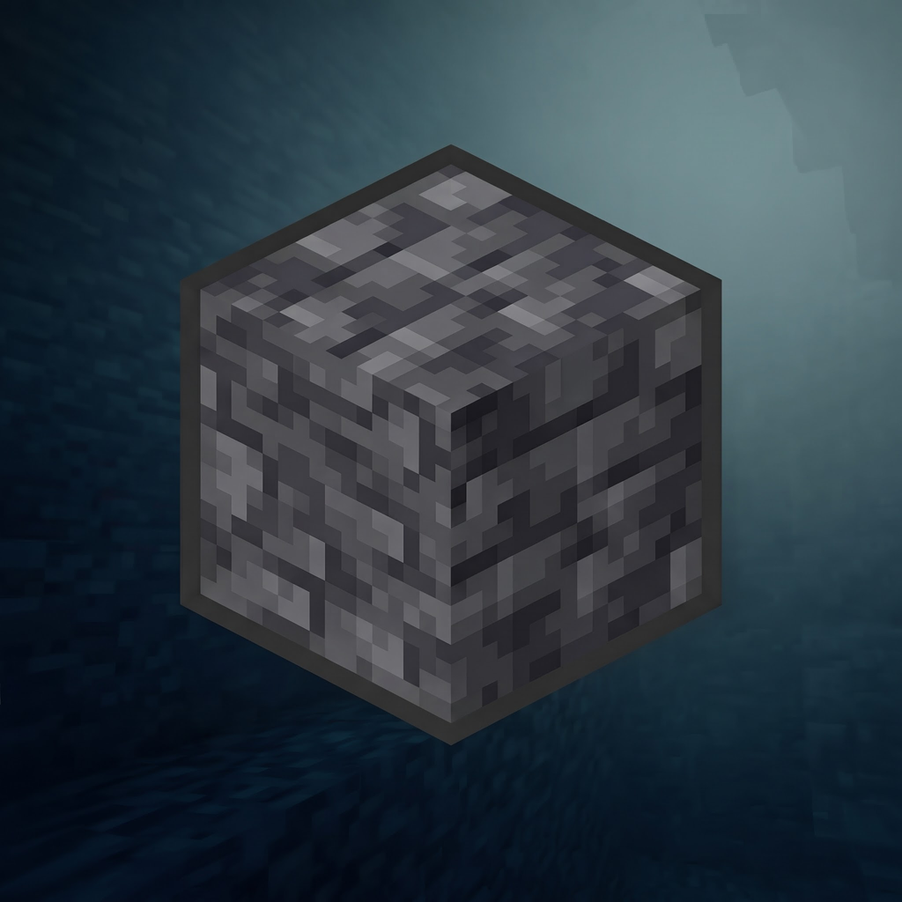

<div align="center">
  
  <h1>Deepslate Launcher</h1>
  <p><strong>A sleek, high-performance Minecraft: Java Edition launcher for Android.</strong></p>

  <p>
    <a href="https://github.com/zacxyonly/Deepslate-Android/releases/latest"></a>
    
    
    <a href="LICENSE"></a>
  </p>
</div>

---

## Overview

**Deepslate Launcher** is a modern, fast, and feature-rich Minecraft: Java Edition launcher tailored for Android devices. Featuring a refined dark aesthetic, deep hardware optimization, and cutting-edge renderer support, Deepslate brings desktop Minecraft to your fingertips with smooth frame rates and effortless customization.

---

## Features

- ⚡ **Modern Renderer Pipeline:** Integrated support for MobileGlues, ANGLE, GL4ES, and Vulkan/Zink backends for superior rendering performance and compatibility with modern Minecraft versions (1.20, 1.21, snapshots & beyond).
- 🌒 **Deepslate Dark Aesthetic:** Custom dark UI designed for low eye strain and premium visual clarity on OLED and LCD screens.
- 🔓 **Frictionless Authentication:** Instant local (offline) and Microsoft account support with automatic game asset downloading.
- 🧩 **Comprehensive Modding Support:** One-click integration for Fabric, NeoForge, Forge, Quilt, and custom runtime JAR installers.
- 🎮 **Tactile Virtual Controls:** Fully customizable on-screen touch controls, mouse emulation, gamepad mapping, and physical keyboard/mouse support.
- ☕ **Multi-Java Runtimes:** Flexible OpenJDK 8, 17, and 21 runtime switching for legacy and modern modpacks.

---

## Download

Get the latest stable APK from the **[Releases](https://github.com/zacxyonly/Deepslate-Android/releases)** page.

1. Download the latest `Deepslate-Launcher-vX.X.X.apk`.
2. Install the APK on your Android device (ensure "Install from Unknown Sources" is enabled).
3. Launch the app, select your preferred Minecraft version or modloader, and jump into the game.

---

## Building from Source

### Prerequisites
- **JDK 21** ([Eclipse Temurin](https://adoptium.net/temurin/releases) or OpenJDK)
- **Android SDK** (API Level 36+, NDK 27.x)
- Linux, macOS, or Windows (WSL2 recommended)

### Build Steps

```bash
# Clone the repository with submodules
git clone --recursive https://github.com/zacxyonly/Deepslate-Android.git
cd Deepslate-Android

# Prepare language files
chmod +x ./scripts/*.sh
./scripts/languagelist_updater.sh

# Assemble release APK
./gradlew :app_pojavlauncher:assembleRelease
```

The compiled APK will be located in:
`app_pojavlauncher/build/outputs/apk/release/app_pojavlauncher-release.apk`

---

## License

Deepslate Launcher is open-source software licensed under the **[GNU Lesser General Public License v3.0 (LGPL-3.0)](LICENSE)**.

---

## Credits & Acknowledgments

Deepslate Launcher is made possible by the incredible work of the open-source community:
- **[PojavLauncher](https://github.com/PojavLauncherTeam/PojavLauncher)**
- **[Amethyst-Android](https://github.com/AngelAuraMC/Amethyst-Android)**
- **[MobileGlues](https://github.com/MobileGlues/MobileGlues)**
- **[Boardwalk](https://github.com/zhuowei/Boardwalk)**
- All upstream contributors to OpenJDK Mobile, GL4ES, SDL3, ANGLE, and OpenAL-Soft.
